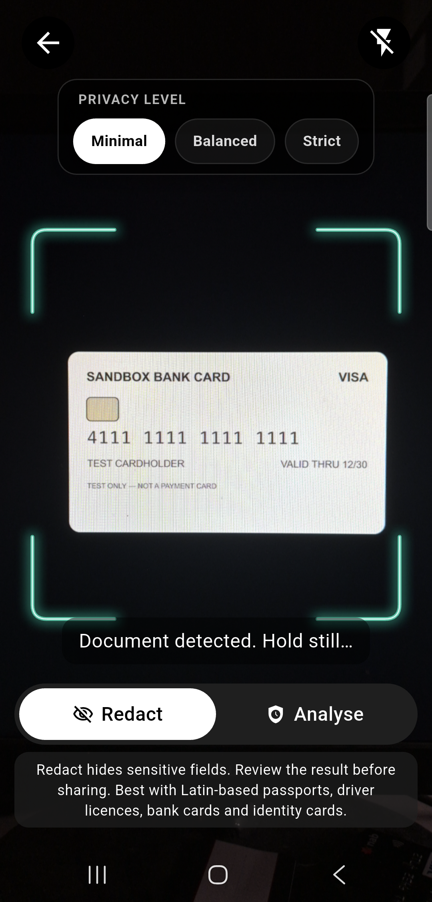

# Supplied scanner route

AresIdentity has the same two integration choices as AresEdge: an SDK-supplied
scanner route, or an embedded camera under your application's UI. The supplied
route uses the AresScan identity layout: black back/torch buttons, privacy-level
controls, Redact/Analyse selection, stable status hints and a fixed animated
capture guide. It never opens or includes an image editor.

See [scanner and result screenshots](visual-demos.md) for a synthetic-card example.



```dart
import 'package:flutter/material.dart';
import 'package:ares_identity/ares_identity.dart';

Future<AresIdentityScanResult?> scanIdentity(BuildContext context) async {
  final result = await AresIdentityScreen.open(
    context,
    licenceKey: const String.fromEnvironment('ARES_IDENTITY_LICENCE'),
    overlayColor: const Color(0xFF00FFD1),
    captureTimeout: const Duration(seconds: 3),
    hintBuilder: (state) => switch (state.phase) {
      'searching' => 'Place your document inside the guide',
      'holding' => 'Keep the document steady',
      'countdown' => 'Capturing in ${state.remainingSeconds}',
      'capturing' => 'Taking photo…',
      'processing' => 'Applying privacy treatment…',
      'error' => 'Could not process this document. Please try again.',
      _ => state.message,
    },
  );
  if (result == null) return null; // Back or trial expiry.
  // Named Dart tuple: result.level is the applied enum;
  // result.bytes is the cropped image after the chosen privacy treatment.
  return result;
}
```

`AresIdentityScanResult` is a named Dart record:
`({AresIdentityRedactionLevel level, Uint8List bytes})`.
The enum values are `none`, `minimal`, `balanced`, and `strict`.

Redact uses the selected privacy policy and returns newly masked cropped-image
bytes. The SDK recognizes text on device, runs the existing native Identity
policy and masking, then removes its temporary OCR input. A processing failure
keeps the route open with an error; it never silently returns the original image
as a redacted result. No sensitive regions found means `none`, not a guarantee
that the document has no sensitive information. Review results before sharing.

Analyse returns the cropped image without masks and level `none`. An optional
`onAnalysis` callback receives the same scan's findings in either mode. Neither
mode returns an uncropped original or detector geometry.

The screen is a Flutter route hosted by the app's existing Activity or
UIViewController. The caller gets `null` on back/trial expiry. For custom routers,
mount `AresIdentityScreen` directly; its optional `onComplete` receives the same
record and makes the host responsible for dismissal. The older `onCapture`
callback remains supported and receives processed cropped pixels/dimensions.
Do not supply both completion callbacks.

The SDK owns the supplied layout. `overlayColor` sets its guide accent;
`hintBuilder` customizes text by state and countdown seconds.
`forceEdgeOverlay` controls continuous native tracking eligibility, not document
fill/grid visibility. Native licensing and capture checks remain authoritative.
For your own layout, controls and processing flow, use the embedded integration.

`captureTimeout` is the stable-document countdown, not a maximum wait for a
scan. It accepts whole seconds from 1 to 10 and defaults to 2. It is enforced
by the native camera; movement or stale detection cancels the countdown. A
non-default value requires native `captureCountdownProtocol: 1`; older cores
show an update message rather than ignoring the requested duration.

## Import an existing photo

The black gallery button opens the system photo picker. Cancellation leaves the
scanner open. Set `allowGallery: false` on `AresIdentityScreen.open` or the widget
to hide it. Selected photos are orientation-normalised and perspective-cropped
by the licensed native Identity detector, then pass through the same selected
Redact/Analyse mode and privacy level as a camera capture. The result remains
`({AresIdentityRedactionLevel level, Uint8List bytes})`; no editor is included.
A photo without a reliable document boundary fails instead of returning the
uncropped original. The native camera is detached during picking and delivery,
then reopens after cancellation or a recoverable failure.

The stable-document countdown applies to the live camera, not gallery imports.
Use a clear photo with all four document corners visible. Add an explanatory
`NSPhotoLibraryUsageDescription` to the host iOS Info.plist and rebuild the app
after adding this SDK dependency. Android uses the system picker without broad
storage permissions. No full photo metadata access is requested.
