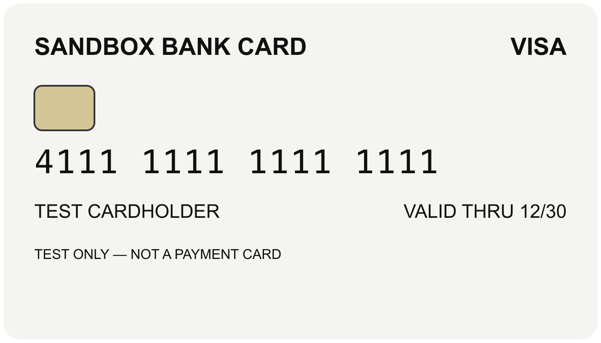
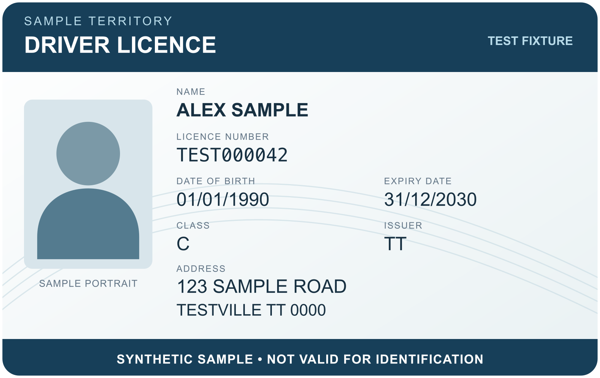

# Synthetic documentation fixtures

Use these fictional cards for developer screenshots and local camera checks.
All names, dates, addresses, identifiers and the portrait are synthetic. The
bank card is the same design as the local sandbox capture fixture.

- [Bank card PNG — 1400 × 800](assets/fixtures/synthetic-bank-card.png)
- [Driver licence PNG — 1600 × 1008](assets/fixtures/synthetic-driver-licence.png)
- Editable SVG sources are beside each PNG.

For camera checks, keep all four corners visible and let the card fill most of
the scanner guide. Monitor moiré can interfere with detection; a printed copy
provides a more consistent physical fixture. A completed capture verifies this
fixture and device configuration, rather than general identity-document accuracy.
