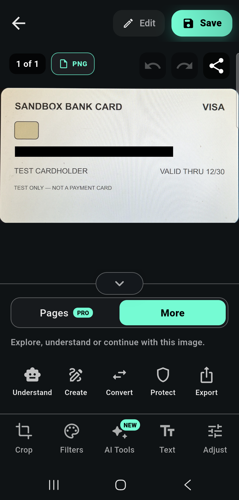

# Identity scanner screenshots

These Android captures use the fictional sandbox bank card from
[the synthetic test fixtures](test-fixtures.md). They illustrate the supplied
scanner and a host application displaying its redacted output.

## Supplied scanner route

The AresScan-style scanner provides black back/flash controls, privacy-level
selection, Redact/Analyse modes, state hints and an animated guide. This capture
shows a detected card and the hold-still hint before automatic capture.
The guide colour, state-based hints and stable-document countdown are
configurable; see [the supplied route](scanner-screen.md). Use
[the embedded camera](embedded-camera.md) for your own layout and controls.

## Cropped image after redaction

The example masks the card number while leaving the synthetic cardholder and
expiry visible. Privacy policies determine which detected fields are masked;
see [recognition and redaction](recognition-and-redaction.md). Review the output
before sharing: this example does not establish complete sensitive-field
coverage for other documents.

The image is shown inside **AresScan+**, the host app. The editor, Save/Share,
Pages, AI Tools and other surrounding controls are not included in AresIdentity.
The supplied SDK route finishes by returning
`({AresIdentityRedactionLevel level, Uint8List bytes})`: cropped image bytes with
the selected privacy treatment and the applied-level enum. Your app decides
how to display, save or share them. Analyse returns cropped unmasked bytes with
level `none`; cancellation returns null.

## Image assets

- [Original scanner screenshot PNG](../media/identity-scanner.png)
- [Original redacted-result screenshot PNG](../media/redacted-card-aresscan.png)

The original supplied screenshots are retained without retouching. The bank
card is labelled TEST ONLY — NOT A PAYMENT CARD and contains synthetic data.
